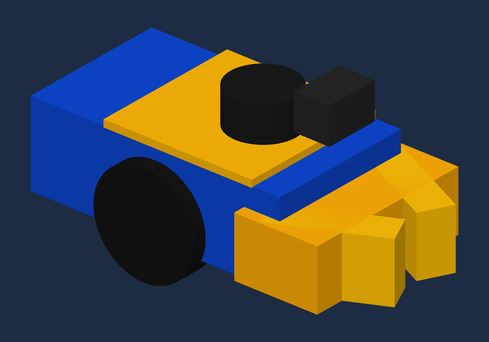
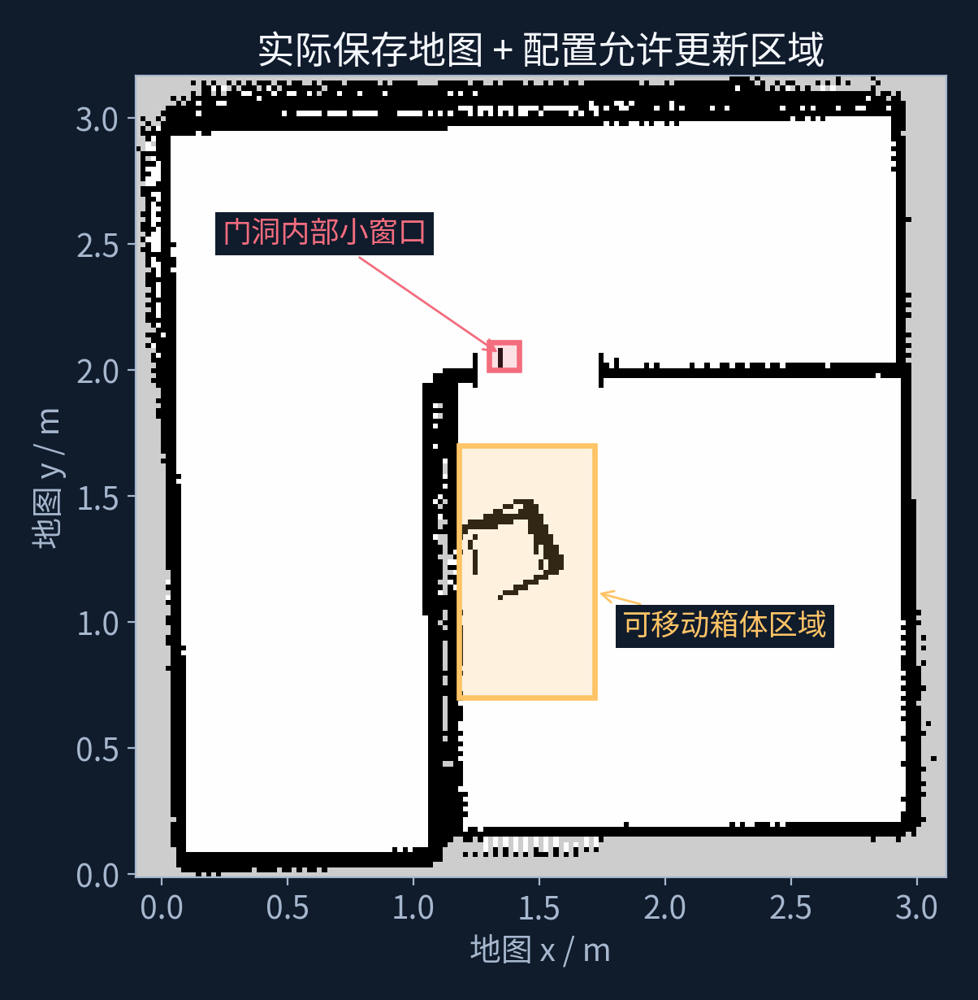
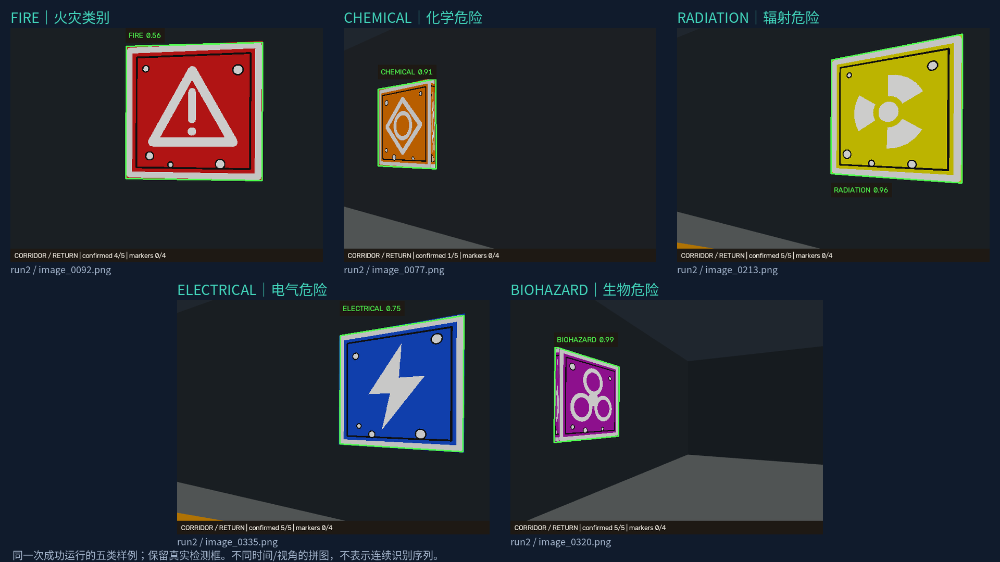
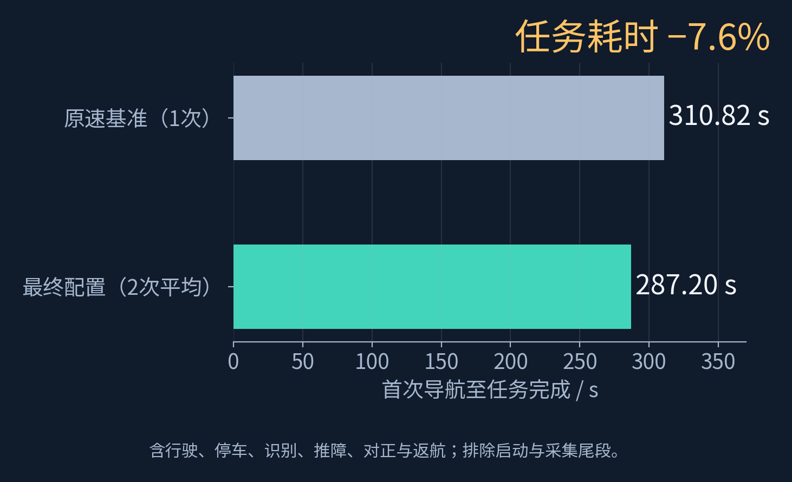

# 无人车仿真组技术实施报告

队伍名称：Simulator　｜　队伍编号：B09018834

参赛组别：仿真技术－无人车仿真组

队长：陈莎莎　｜　队员：梁辰瑜、赖丽燕、初冉

指导教师：邓彦松

## 1. 任务与总体方案

我们以封闭厂区救援勘探为任务背景，设计并实现了一辆救援无人车：车辆从起点出发，在走廊确认五类灾情图案，到核心区入口通过实体接触推开箱体，进入室内识别四个 AprilTag 并发布地图 Marker，最后返回起点。我们采用 ROS 2 Humble、Gazebo Classic 11、Nav2、AMCL、slam_toolbox、PyTorch 和 OpenCV。`mission_node` 负责任务编排，导航负责车辆移动，物理云台负责侧墙观察，视觉节点负责类别和标签定位，安全节点在底盘执行前检查速度指令。

任务路线、目标朝向、速度档位、观察超时和识别阈值位于 YAML 中。五类走廊事件、四个核心标签、推障和返航均满足条件后才能报告完成；漏识别、导航失败、推障偏离、传感器失效或持续受阻将停车中止。

针对侧墙观察、窄门清障和标识定位等问题，我们进行了六项改进：云台扫描与多帧确认、推障结构与受约束控制、激光自由证据地图处理、轻量 YOLOv5 多级核验、分阶段速度精度协同，以及运动云台下的时间同步定位。各项改进的设计、实现和测试结果如下。

## 2. 场景、建图与定位基础

我们搭建了 3 m × 3 m 的救援场地，包含外围走廊、核心区、0.50 m 入口、可推动箱体和九块互不相同的无文字识别板。Gazebo 加载 `worlds/rescue_world.world`；导航使用 `maps/rescue_map.yaml` 和配套占据栅格 `rescue_map.pgm`，分辨率为 0.02 m。PGM 是二维定位与规划地图，三维场景由 world/SDF 描述。

激光雷达每圈采样 360 点，测距范围 0.08–8.0 m，更新率 15 Hz。`start_mapping.sh` 启动 slam_toolbox 建图，`save_map.sh` 备份旧地图并保存 PGM/YAML。常规导航由 AMCL 根据激光和里程计定位，Smac2D 使用栅格 A* 规划，Regulated Pure Pursuit 跟踪路径。出生点和初始定位共同读取配置，当前为 `(0.55, 0.54, 1.5708)`，单位为米、米、弧度。

启动脚本隔离 ROS Domain、Gazebo master 和场景服务分区，检查场景模型，并在 AMCL、规划器、控制器、导航器、速度平滑器激活及地图、里程计就绪后启动任务。导航保持前进行驶，任务使用无自动旋转和倒车恢复的行为树；去程限制异常累计转角，返航阶段允许必要掉头。

## 3. 创新一：云台扫描与多帧确认协同

相机输出 640 × 480、15 Hz 图像，视觉每两个相机帧处理一次。`camera_scan_node` 在 ±1.90 rad 范围发出周期 12 s 的正弦扫描目标，由关节电机插件驱动云台，实际关节角通过 `/joint_states` 更新 TF。底盘沿路线行驶，云台观察两侧墙面，减少为了看标识而反复转动车体。

到观察点后先停车至少 0.8 s，并核对实际速度达到停止条件，再进入最长 28 s 的观察窗口。同一危险标识须在连续三个空间关联的处理帧中出现，才发布 `/hazards/detections` 供任务确认；完成确认后至少再停留 1 s。显示框可在当前一个核验通过的帧出现，历史确认计数和当前显示框分别表达任务状态与瞬时观测。标签定位采用至少四次有效观测，规则与危险标识的连续三帧确认不同。

## 4. 创新二：推障机构与受约束控制协同

差速底盘前端采用横梁和两侧导流翼组成的被动 V 形推板，用几何结构引导箱体接触，降低执行机构复杂度。推板横梁宽 0.28 m，轮缘决定的整车最大宽度约 0.285 m。Gazebo 碰撞模型、URDF 和 Nav2 完整轮廓同步，包含底盘、轮组及突出车头的推板；代价地图另保留 0.01 m 轮廓边界余量。

图 1　根据 rescue_rover/model.sdf 渲染的车辆结构，包含前端推板、驱动轮、雷达和云台。

箱体为 0.30 m × 0.30 m × 0.30 m、2 kg 的非静态刚体，由 Gazebo 接触与摩擦改变其位置。`pushing` 阶段根据里程计闭环调整前进和航向：车辆沿起始航向的目标位移 1.08 m、限速 0.10 m/s、超时 24 s，横偏超过 0.04 m 或航向偏差超过 0.12 rad 中止。车辆推进目标与箱体实际位移分开记录，后者由独立验收测量。

`safety_node` 位于速度平滑器和车轮执行之间，依据激光检查包含推板的完整停车扫掠区域，同时检查裁剪后的指令速度和未裁剪的实际里程计速度，保留 0.035 m 安全余量。惯性速度高于指令时仍扩大保护范围；激光、里程计、指令或必要 TF 失效则停车。低速推障只允许目标箱体的有界前方接触，侧后障碍继续检查。

推障完成后单独转向脱离。接触例外固定于推完时的箱体区域，最长 12 s，允许的总平移不超过 0.06 m，不能随车头转向将墙面纳入授权，结束后恢复普通检查。我们采用几何引导和里程计闭环完成清障。由于未配置力传感器，箱体初始位置偏移较大时的推进稳定性仍需进一步测试。

## 5. 创新三：激光自由证据驱动的地图残影处理

箱体移动后，旧静态地图中的占用可能继续封堵通道。`navigation_map_node` 保留原始 PGM 和 `/map`，在排除结构墙的限定区域内累计自由射线证据；同一栅格获得三个不同时间戳扫描的自由证据后，才更新派生 `/navigation_map`。证据不要求来自连续扫描，射线在量测障碍前 0.08 m 截止，目标新位置继续由实时激光障碍层标记。

图 2　rescue_map.pgm 上的地图清理允许区域，区域边界由 navigation_map.yaml 配置。

方法同时处理旧箱占用和窄门窗口的孤立占用格，恢复规划可通行性。我们根据场地布局限定处理范围，排除固定墙体。测试中车辆能够完成清障后的进出通行；目前保存了轨迹和验收结果，尚未记录派生地图逐格更新过程。

## 6. 创新四：轻量 YOLOv5 与图案、几何、时序多级核验

五类无文字走廊图案为 FIRE、CHEMICAL、RADIATION、ELECTRICAL、BIOHAZARD，由 `tools/generate_assets.py` 生成。项目内轻量 YOLOv5 采用 C3/SPPF 主干、PAN 颈部和三个 anchor 检测尺度，320 × 320 输入，导出 TorchScript 在 CPU 推理。我们参考 YOLOv5 架构实现网络，并使用本场地的合成图像进行训练。

旧训练缺少足够无目标场景，曾将黄色车身、蓝色起点和红色推障箱误报为 RADIATION、ELECTRICAL 和 FIRE，原始框也可能超出图案或在候选之间跳变。训练集约 35% 的图像不含目标，加入红箱、蓝色起点、黄色车身、无图案同色牌、AprilTag 和背景负例，并覆盖远近、透视、亮暗、模糊、噪声和遮挡。定位损失加入 CIoU，验证匹配 IoU 使用 0.50；达到 precision ≥0.80、recall ≥0.70、空场景图像误报率 ≤0.05 才导出权重。

推理链为全图 YOLO → 注册白色图案核验和面板边界拟合 → 必要时区域放大重检 → 类别内 NMS → 空间关联与连续确认。全图置信度下限为 0.45；区域恢复仅由已通过图案核验的候选启动，放大区域仍须再次由 YOLO 分类，局部下限为 0.25。真实牌边拟合用于限制大框；空间关联检查面积、中心跳变和重叠，只平滑当前目标的小幅轮廓抖动，目标消失即清除显示。权重或 PyTorch 缺失时启用 SIFT/RANSAC/颜色匹配并告警。

图 3　speed_mixed_020_20261012_run2 运行中的五类标识检测画面。原图文件及来源见 docs/report_assets/sources.json。

当前权重由项目先前从零训练的权重续训，独立合成验证 160 张，precision=0.8562、recall=0.7081，59 张无目标图中 2 张误报。上述指标来自合成验证集。完整任务测试中五类标识均完成确认，但截断、远距或斜视目标仍有瞬时漏检，后续需要增加仿真视频的逐帧标注评估。

紫红色 `PUSH BARRIER` 框来自独立红箱图像检测器，发布 `/obstacles/detections` 像素框供显示。它与灾害绿框区分，不读取模型真值，也不参与导航或推障控制。我们针对云台扫过红色印刷牌时的箱体误报调整了检测条件，测试记录见 `docs/barrier_tail_fix_validation.json`。

## 7. 创新五：面向任务阶段的速度与精度协同

普通路段使用 0.20 m/s 和 0.40 rad/s 对正速度；窄门、推障对正和最终起点使用 0.12 m/s、0.35 rad/s；实体推箱仍为 0.10 m/s。普通位置容差 0.05 m、到点减速距离 0.20 m；精细路段保留 0.025 m 和 0.40 m；朝向容差为 0.045 rad。阶段由配置选择控制器与行为树，速度平滑器总限值为 0.20 m/s、0.50 rad/s，实际移动还受路径曲率、近点减速和安全检查约束。

普通任务导航先到位置，再基于当前位置单独对正朝向，避免 AMCL 更新后为了旧终点反复微调。识别权重、图案核验、12 s 扫描周期、三帧危险标识确认、至少四次标签有效观测、28 s 观察上限和停车条件均保留。我们通过任务分档和减少末端纠偏缩短耗时，速度参数按任务阶段预先配置。

图 4　速度对比实验：一次原速基准与两次最终配置运行。首次导航至完成包括行驶、转向、观察、推障及返航，排除编译、启动等待和采集尾段；平均 310.82 → 287.20 s，节省 23.62 s（7.6%）。三次实验均在无界面条件下进行。

| 历史速度试验 | 首次导航至完成 / s | 四 Marker 误差 / cm | 返航误差 / cm |
| --- | --- | --- | --- |
| 原速基准 run1 | 310.82 | 3.47–6.86 | 3.99 |
| 最终 0.20，第 1 次 | 286.07 | 7.67–12.83 | 3.85 |
| 最终 0.20，第 2 次 | 288.32 | 4.41–6.83 | 5.25 |

最终两次均完成五类识别、四标签、清障和返航，箱体实际位移为 1.0035 m、1.0049 m，墙体重叠采样均为空。第 2 次目录为 `acceptance/speed_mixed_020_20261012_run2`，该次未启用独立在线 SLAM 记录。全程 0.24 m/s 和分档 0.30 m/s 有失败候选；分档 0.24 虽通过但任务更慢。综合完成情况与任务耗时，我们选择普通路段 0.20 m/s 作为最终配置。

速度试验保留 22 个识别相关文件与基准一致的哈希，两次最终试验的 93 个源文件哈希相同；165 项回归测试在该轮通过。完整事件集说明任务目标完成，定位误差仍有运行波动。详情和原始记录见 `docs/speed_tuning_validation.md/json`。

## 8. 创新六：运动云台下的时间同步定位与地图标注

四个核心标识使用互不相同的图案、色带和 AprilTag 36h11 ID 0–3，对应 COLLAPSE、TOXIC_LEAK、TRAPPED_PERSON、HIGH_TEMPERATURE。车辆进入核心区后，以相机内参和 0.1875 m 标签边长通过 `solvePnP(IPPE_SQUARE)` 求相机坐标，再沿实际云台、底盘和定位 TF 转到 `map`。

TF 使用图像消息的拍摄时刻，而非处理完成时刻；队列等待变换就绪，超过 1 s 的旧帧丢弃，避免移动云台角度与图像错配。只接受有限数值、正深度和平均重投影误差不超过 2.5 px 的观测；至少四次有效观测后确认，保留最近 20 个位置样本取中值，拒绝离已有位置超过 0.20 m 的异常点，再以 0.35 系数平滑。缺帧不清空标签样本，因此这里的四次观测无需连续。

结果在 `/hazards/core_markers` 发布彩色 Marker、类别和 ID，RViz 用同一 ID 对应相机中的标签。定位不读取模型真值坐标；我们通过 Tag ID 与语义表的对应关系确定核心类别。地图标注的误差除视觉测量外还受 AMCL 和地图漂移影响。

## 9. 整车测试与演示结果

我们使用独立验收程序 `run_acceptance.py`，开启图像采集和建图记录，保存任务事件、图像、车辆与箱体轨迹、Marker、源码哈希和独立 SLAM 证据。独立 slam_toolbox 不向导航定位链路发布 TF，其地图只留档，不替换导航原图。每次运行的建图状态记录在 `evaluation.json` 中。

验收工具独立读取 `/evaluation/model_states`，任务、控制和视觉节点不订阅该真值话题。Marker 误差通过记录的 map←odom 变换将真值与视觉结果放到同一坐标系后比较，同时保存原始 world/map 坐标差。墙体检查采用离散采样的完整轮廓；没有重叠采样并不能替代连续接触传感器。

我们为完整任务设置了以下验收条件：任务完成、五类走廊识别、四个核心 Marker 有转换记录且平面误差小于 0.15 m、箱体位移大于 0.50 m、返航误差小于 0.10 m、至少一帧红箱正检测，墙体重叠采样为空；启用在线建图时还检查地图留档。验收结果见下表及附录，速度对比实验见第 7 章。

我们使用 `record_submission.py` 录制了一键启动后的完整任务过程。同屏显示 Gazebo、RViz、实时终端事件、系统时间与 `/camera/annotated` 车载第一视角。走廊显示绿框分类和确认状态，红箱显示紫红色 PUSH BARRIER 框，核心区显示 ID、类别和估计 map 坐标，与 RViz Marker 对应。录像记录了五次走廊确认、实体推障、四个核心标记和最终返航，播放速度在画面中标注。

我们在开启 Gazebo、RViz、在线 SLAM 和屏幕采集的条件下完成了整车演示。运行记录保存在 `acceptance/recording_submission_20261012_update`，测量结果见 `evidence/evaluation.json`。车载识别画面更新 530 帧，完整任务的实测结果如下。

| 本次连续录屏指标 | 实测值 |
| --- | --- |
| 自动验收 / 任务完成 | 通过 / 是 |
| 首次导航至任务完成（事件时间差） | 352.66 s |
| 采集运行时长（含启动和采集尾段） | 374.02 s |
| 最终视频播放时长（统一 2 倍速） | 195.934 s |
| 走廊类别 / 核心标签 | 5 / 4 |
| 箱体实际位移 | 1.0008 m |
| 返航位置误差 | 0.0518 m |
| 红箱正检测帧数 | 132 |
| Tag 0／1／2／3 同坐标系平面误差 | 0.0883／0.0899／0.0877／0.0910 m |
| Tag 0／1／2／3 原始 world/map 坐标差 | 0.1476／0.1450／0.1433／0.1321 m |
| 独立在线 SLAM 留档 | 已保存 |
| 墙体轮廓重叠采样数 | 0 |

根据任务事件时间戳，首次导航至完成耗时 352.66 s；含启动和采集尾段的运行时长为 374.02 s。整车演示增加了图形界面、在线 SLAM 和屏幕采集负载，因此与第 7 章的无界面速度实验分别统计。

最终视频由原始连续录屏 391.5333 s 统一 2 倍速导出，画面标注倍速，播放时长 195.934 s（约 3 分 16 秒），大小 9,503,690 字节（约 9.50 MB），1920 × 1080、15 fps、H.264。我们将完整任务过程以统一 2 倍速呈现，原始录像与日志保存在 acceptance 目录。

## 10. 工程贡献、第三方范围与复现

我们完成了场地和无文字标识、被动推板结构、物理云台插件、轻量模型定义与合成训练、图案及几何核验、区域恢复、跨帧关联、时间同步定位、地图残影处理、阶段化控制和独立验收录屏工具。相关实现见工程源码，测试结果见验收记录。

ROS 2、Gazebo、Nav2、slam_toolbox、PyTorch、YOLOv5 架构思想、OpenCV 与 AprilTag 为第三方基础组件，我们在这些组件上完成场地适配、任务控制和感知处理。依赖版权与许可见 `docs/third_party.md`。模型只验证本项目五种走廊图案及当前仿真域；修改墙体、标识、纹理、相机内参或标签尺寸后，需重新训练、标定和验收。

在 avs_ws 执行 `./start.sh` 一键编译和启动；建图使用 `./start_mapping.sh`、`./save_map.sh`。执行 `python3 src/avs_rescue_sim/tools/build_submission.py acceptance/所选运行` 生成源码 ZIP 和依据本源稿的 PDF，所选运行必须含 evaluation.json；独立生成报告使用 `python3 src/avs_rescue_sim/tools/build_technical_report.py --acceptance acceptance/所选运行 --output technical_report.pdf`。如录屏目录的测量在 evidence 子目录，应将其作为 acceptance 参数。

报告中的模型渲染、区域示意、实验统计图和相机截图的来源记录见 `docs/report_assets/sources.json`。
