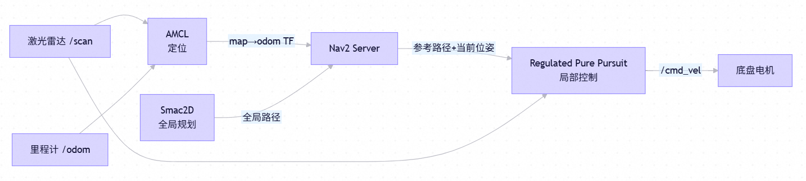
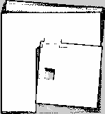

# 无人车仿真组技术实施报告

队伍名称：Simulator　｜　队伍编号：B09018834

参赛组别：仿真技术－无人车仿真组

队长：陈莎莎　｜　队员：梁辰瑜、赖丽燕、初冉

指导教师：邓彦松

## 1. 总体方案

系统基于 ROS 2 Humble、Gazebo Classic 11、Nav2、AMCL、slam_toolbox 和 OpenCV。`mission_node` 依次执行走廊巡检、入口定位、推障清障、核心区标定和返航，要求确认五类走廊标识与四个核心标识。任务路线、目标朝向、速度与主要检测阈值配置在 YAML 中，各项参数在运行前设置。

## 2. 环境与建图

场景为 3 m × 3 m 救援场地，包含外围走廊、核心区、0.50 m 入口、可推动箱体和九块识别板。Gazebo 加载本包 `worlds/rescue_world.world`；二维导航加载 `maps/rescue_map.yaml` 与配套 `rescue_map.pgm`，地图分辨率为 0.02 m。PGM 提供定位与规划所需的二维占据栅格。

激光雷达每圈采样 360 点，测距范围 0.08–8.0 m，更新率 15 Hz。`start_mapping.sh` 使用 slam_toolbox 建图，`save_map.sh` 备份旧地图并保存新的 PGM/YAML。常规导航保留原始地图，由 AMCL 根据激光与里程计定位。出生点与初始定位共同读取导航配置，当前为 `(0.55, 0.54, 1.5708)`，单位分别为米、米、弧度。

为处理箱体被推动后的静态地图残影，`navigation_map_node` 只在不含墙体的指定区域内，经三次不同激光扫描确认空闲射线通过后更新 `/navigation_map`；实时障碍层继续标记当前箱体。原始 PGM 与 `/map` 保留。启动脚本隔离 ROS Domain、Gazebo master 和场景服务分区，并检查世界模型，减少其他仿真进程干扰。

## 3. 视觉识别

车载相机输出 640 × 480、15 Hz 图像。`camera_scan_node` 以约 12 秒为周期在 ±1.90 rad 范围内发出左右扫描目标，`avs_rescue_plugins` 的关节电机插件驱动云台，实际关节角通过 `/joint_states` 更新 TF。观察墙面时不需要车体反复掉头；图像处理等待拍摄时刻的 TF 就绪，过期帧被丢弃，避免用较新的云台角度转换较早的图像。

全部九张墙面标识使用互不相同的无文字图案，核心区同时配置 AprilTag。走廊图案由本项目 `tools/generate_assets.py` 生成，类别为 FIRE、CHEMICAL、RADIATION、ELECTRICAL、BIOHAZARD。默认检测器为项目内实现并从零训练的轻量 YOLOv5 架构：C3/SPPF 主干、PAN 颈部与 3 个 anchor 检测尺度，320×320 输入并导出 TorchScript 在 CPU 推理。旧版训练缺少足够的无标识场景；彩色车身、蓝色出发区、红色推障箱曾触发 RADIATION、ELECTRICAL、FIRE 误报，原始检测框也可能比图案大或在不同候选框间跳变。

训练集约 35% 的图像不含目标，负样本包括红箱、蓝色起点、黄色车身、同色无图形面板和 AprilTag 负例；定位损失加入 CIoU，验证匹配 IoU 提高至 0.50。精确率须达到 0.80、召回率须达到 0.70，且空场景图像误报率不高于 0.05，才导出推理权重。当前权重由本项目先前从零训练的权重续训，独立 160 图验证 precision 为 0.8562、recall 0.7081，59 张无目标图有 2 张误报，推荐阈值 0.45。推理时 `PanelGeometryVerifier` 检查候选区域的颜色与内侧白色图案是否符合相应纹理，并从相机图像拟合透视面板边界；验证通过后再做类别内 NMS 和单牌选择。`HazardTracker` 关联相邻处理帧的位置与尺寸，同一牌连续出现 3 帧才发布 `/hazards/detections`；只平滑小幅轮廓抖动，目标消失即清除显示框。这样减少纯色物体误报和框跳动；合成验证的精度不等同于整段视频的实地逐帧准确率。权重或 PyTorch 缺失时，系统启用 SIFT、RANSAC 与颜色匹配作为备用识别方法，并发出告警。

核心板采用无文字图案、色带与第三方 AprilTag 36h11 字典的 ID 0–3。车辆进入核心区后，节点利用相机内参和 0.1875 m 标签边长，通过 `solvePnP(IPPE_SQUARE)` 计算相机坐标，再用拍摄时刻的 TF 转换到 `map`。当前重投影误差上限为 2.5 像素，至少 4 帧确认；保留最近 20 个样本取中值，拒绝与既有位置偏差过大的观测，并以 0.35 系数指数平滑。在 `/hazards/core_markers` 发布彩色标记及标签 ID，RViz 展示其地图位置。识别流程不读取模型真值坐标。

红色推障箱由独立的图像检测器识别，在 `/camera/annotated` 中显示紫红色边界框与 `PUSH BARRIER` 标签，并通过 `/obstacles/detections` 发布像素边界框 JSON。该结果用于展示相机观测，检测器使用相机图像，发布结果为像素坐标，用于画面展示。

## 4. 推障机构与物理参数

差速底盘前端安装横梁与两侧导流翼组成的被动 V 形推板，用于引导箱体接触。横梁宽 0.28 m，整车最大宽度约 0.285 m；Gazebo 碰撞模型、URDF 与 Nav2 完整轮廓同步。障碍物为 0.30 m × 0.30 m × 0.30 m、2 kg 的非静态刚体，依靠 Gazebo 刚体接触与摩擦推动，推障过程中保留箱体模型，由接触力改变其位置。

`pushing` 阶段根据里程计闭环检查前进距离、侧偏与航向。当前目标位移为 1.08 m，限速 0.10 m/s，超时 24 s，侧偏上限 0.04 m、航向偏差上限 0.12 rad。推障后单独原地转向脱离接触，接触例外固定在原箱体区域，最长 12 s、允许的总平移不超过 0.06 m，随后恢复普通碰撞检查。验收时通过箱体位移和车辆通行结果判断清障是否成功。

## 5. 导航与返航

图 1　导航模块及主要数据关系。图中简化了 Nav2 内部接口；实际控制指令经速度平滑器和 `safety_node` 检查后送入底盘驱动。激光数据同时用于定位、代价地图更新和碰撞检查。

Nav2 使用 Smac2D 的栅格 A* 进行全局规划，Regulated Pure Pursuit 跟踪路径。普通前进限速 0.12 m/s，速度平滑器限制转向速度为 0.4 rad/s；全局与局部代价地图的膨胀半径均为 0.22 m，代价衰减系数为 8.0，碰撞轮廓保留车体、车轮、推板及 0.01 m 边界余量。

保存的 SLAM 地图在返航门洞内部曾出现孤立占用格，使全局规划器把车辆起点判为障碍。运行时保留原始 PGM，仅在物理门墙之外的窄门窗口，经过三次独立激光空闲射线确认后更新派生导航地图；真实障碍仍由激光代价层和完整车体安全检查保护。最终连续录像已通过该门洞并返回起点。

任务启动前等待 AMCL、规划器、控制器、导航器、速度平滑器激活，以及导航地图和里程计就绪。普通任务导航拆分为到达位置、在当前位置对正朝向两个阶段，减少定位微调导致的末端反复纠偏。观察最多等待 28 s，覆盖两次云台扫描，确认所需标识后继续；去程限制异常累计转角，仅回程阶段允许掉头。任务与交互式导航使用不含自动旋转、倒车恢复的行为树，禁止倒车行驶。

`safety_node` 位于速度平滑器与车轮驱动之间，根据激光、当前速度和制动过程检查完整车体轮廓。只有有界推障与脱离接触阶段允许目标箱体接触，其余障碍仍检查；指令、激光或里程计超时则输出零速度。漏识别、导航失败、推障偏离或持续受阻会中止任务，全部规定标识确认后，任务才进入完成状态。

## 6. 开发内容与第三方组件

本工程实现内容包括场地与标识、被动推板结构、物理云台插件、参数化任务编排、图案验证与面板轮廓拟合、跨帧确认与 TF 缓冲、导航地图残影处理、四窗口实时展示，以及独立验收与录屏工具。

ROS 2、Gazebo、Nav2、slam_toolbox、PyTorch、YOLOv5 架构思想、OpenCV 和 AprilTag 均为第三方基础组件。项目内完成轻量网络定义、合成数据生成、训练与验证阈值检查、TorchScript 推理与 ROS 集成；模型只针对本项目五种自定义图案及当前仿真域，尚未验证其他图案和真实灾害场景。地图与路线针对自建场地，修改墙体、纹理、标签尺寸或相机参数后需要重新训练/标定并验收。依赖版权与许可说明见 [third_party.md](docs/third_party.md)。

## 7. 验收方法与测试结果

在工作空间内运行 `python3 src/avs_rescue_sim/tools/run_acceptance.py --images --mapping-evidence`，保存日志、任务事件、图像、车辆与箱体轨迹、检测结果和 Marker。独立 SLAM 将本次在线生成的占据栅格保存为 `slam_map.pgm/yaml/png`，不替换导航原图，也不向导航定位链路发布 TF。

验收工具独立读取 `/evaluation/model_states`，任务、控制与视觉节点不订阅该真值话题。Marker 误差使用记录的 `map←odom` TF，将标识真值和视觉结果转换到同一坐标系后比较；同时保留原始 world/map 坐标差，避免把地图定位偏移视为纯视觉误差。墙体检查使用离散采样位姿上的完整车体轮廓，检查结果反映采样时刻的轮廓关系。

当前自动检查要求：任务完成、五类走廊识别、四个核心 Marker 均有坐标转换记录且平面误差小于 0.15 m、箱体位移大于 0.50 m、返航位置误差小于 0.10 m、相机至少产生一帧红箱检测，并且没有采样轮廓与墙体重叠。启用在线建图证据时还检查地图是否保存。这些是工程验收阈值，比赛成绩以裁判评分为准。历史无界面全任务验收 为 `passed=true`：五类走廊标识与四个核心 Marker 齐全，箱体位移 0.9775 m，返航位置误差 0.0329 m，四个 Marker 同坐标系平面误差 0.0146～0.0591 m，红箱正检测 375 帧，在线 SLAM 已记录，采样车体与墙体重叠为空。该组数据来自无界面测试；连续录屏对应的结果另列如下。

独立验收仅统计最终事件、地图定位和红箱检测帧数，没有逐帧统计黄色车身、蓝色起点或红箱被误判为灾害牌的比率，也没有自动测量整段画面的牌框 IoU。误报和检测框抖动通过增加同色无图案负样本、核验牌面图案、拟合面板四角和关联连续帧处理；其单帧合成验证指标与完整任务验收分别记录。历史调试结果保存在调试摘要中。

连续录屏对应的验收记录见 `docs/acceptance_evaluation.json`。

| 指标 | 实测值 |
| --- | --- |
| 自动验收 | 通过 |
| 运行记录时长 | 396.8 s |
| 任务完成 | 是 |
| 走廊类别数 | 5 |
| 核心 Marker 数 | 4 |
| 箱体位移 | 0.9749 m |
| 红箱识别帧数 | 225 |
| 返航位置误差 | 0.0319 m |
| 独立在线 SLAM 地图 | 已保存 |
| 墙体轮廓重叠采样数 | 0 |
| Tag 0／1／2／3 平面定位误差 | 0.0459／0.0679／0.0511／0.0566 m |
| Tag 0／1／2／3 原始 world/map 坐标差 | 0.1504／0.1650／0.1359／0.1231 m |

图 2　该次运行在线生成的 SLAM 占据栅格，导航仍使用原有地图。

## 8. 系统展示与演示流程

系统采用四窗口展示方式，依次打开 Gazebo 场景、RViz 地图、车载相机识别画面和实时任务日志。相机订阅 `/camera/annotated`，日志显示巡检识别、核心标签、任务进度、安全状态及系统时间。启动时根据屏幕自动排布，上方为场景与地图，下方为相机与日志；RViz 采用精简布局。仅调整本次启动的窗口，之后可自行移动；不支持自动排布时可手动调整。任务结束后保留窗口，按 Ctrl-C 统一退出。四个视角便于观察导航、感知与任务执行过程；普通启动不录屏，也不依赖历史验收目录。

在工作空间内运行 `python3 src/avs_rescue_sim/tools/record_submission.py`，由录屏工具启动验收流程。视频画面同时显示 Gazebo 场景、RViz 地图、实时终端事件、系统时间和识别处理后的车载相机第一视角 `/camera/annotated`。相机画面随云台左右扫描，走廊内叠加分类框与多帧确认状态；进入核心室内后叠加 AprilTag ID、灾情类别及估计的 `map` 坐标。相机中的标签 ID 与 RViz 实时 Marker 对应，用于核对图像中的标签与地图上的位置；红色推障箱以紫红色 `PUSH BARRIER` 框显示。

全过程连续展示五次 `[CORRIDOR]` 打印、Nav2 路径、推板推动红色障碍物、四个 `/hazards/core_markers` 以及最终任务状态。连续演示录屏的 `recording.json` 为 `status=complete, continuous=true`，处理后第一视角更新 929 帧。对应独立验收确认五类走廊图案、四个核心 Marker，箱体位移 0.9749 m、返航误差 0.0319 m、Marker 平面误差 0.0459～0.0679 m、红箱正检测 225 帧、采样墙体重叠为空。演示 MP4 统一 2 倍速、207.2 s、9,169,583 字节。录屏工具会在录制目录父目录导出最终 MP4；原始录屏和验收日志归档到 `acceptance/`，提交材料包含 MP4、PDF 和源码 ZIP。画面标注统一 2 倍速。
